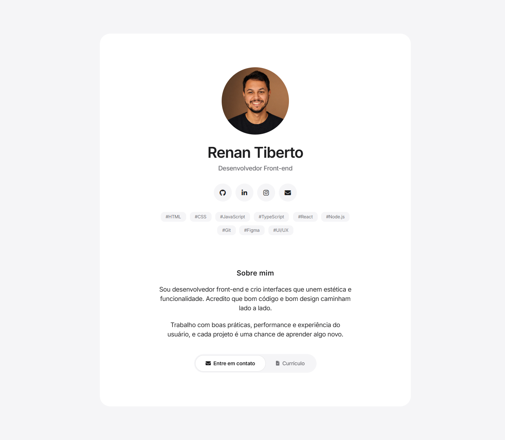

# Renan Tiberto — Portfólio

## 📋 Descrição

Página de apresentação pessoal: foto, cargo, redes sociais, tecnologias
com que trabalho, um texto curto sobre mim e acesso direto ao contato
por e-mail e ao currículo.

## ✨ Funcionalidades

- **Responsiva**: testada em 360px, 768px e 1280px, sem rolagem horizontal
- **Seletor Contato / Currículo**: uma pílula desliza até o botão com hover ou foco do teclado
- **Animações de entrada**: cada elemento entra em sequência, e tudo fica parado para quem ativa "reduzir movimento" no sistema
- **Acessível**: navegação completa por teclado, foco visível e textos alternativos
- **Design system**: cores, fontes, raios e espaçamentos vêm só dos tokens

## 🛠️ Tecnologias

- HTML5
- CSS3 (variáveis CSS, sem framework)
- JavaScript puro
- Google Fonts (Inter)
- Font Awesome

## 👤 Autor

**Renan Tiberto**

- GitHub: [@renantiberto](https://github.com/renantiberto/)
- LinkedIn: [renan-tiberto](https://www.linkedin.com/in/renan-tiberto/)

---

© 2026 Renan Tiberto. Todos os direitos reservados.
